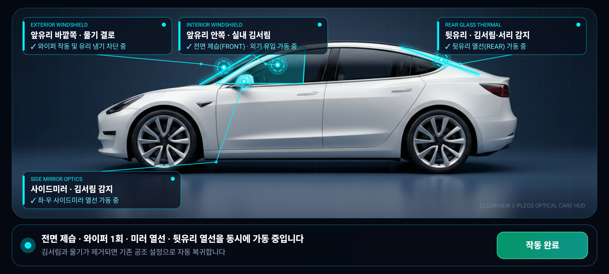

# 클리어뷰 (ClearView)

## 1. 앱 이름 및 한 줄 소개
- **앱 이름**: **클리어뷰 (ClearView)**
- **한 줄 소개**: 유리 **안쪽·바깥쪽 김서림 원인**을 스스로 구분해 공조·와이퍼·열선을 정밀 제어하고, 한 화면의 **차량 측면 홀로그래픽 HUD(상태 · 알림 · 적용)**로 앞유리·사이드미러·뒷유리 시야를 원터치 복구해 주는 Pleos Connect 시야 케어 앱입니다.

---

## 2. 실행 방법

### 방법 A. 빌드된 Release APK 바로 설치 및 실행 (권장)
저장소 내 `apk/` 폴더에 서명 완료된 실행 가능한 Release APK가 포함되어 있습니다.

```bash
# ADB가 연결된 Pleos Connect 에뮬레이터 또는 Android 기기에 설치
adb install -r apk/ClearView_ClearView_release.apk

# 앱 즉시 실행
adb shell am start -n ai.pleos.playground.clearview/.MainActivity
```

### 방법 B. 소스 코드에서 직접 빌드 및 실행
본 프로젝트는 Pleos Connect 공식 Maven 저장소(`https://nexus-playground.pleos.ai/repository/maven-releases/`)의 `ai.pleos.playground:Vehicle:2.3.2` SDK를 사용합니다.

```bash
# 1. 저장소 클론 후 프로젝트 폴더 이동
git clone <REPOSITORY_URL>
cd clearview-pleos

# 2. Release APK 빌드 (JDK 17 또는 21 필요)
./gradlew assembleRelease

# 3. 생성된 APK 확인
ls -lh app/build/outputs/apk/release/app-release.apk
```

---

## 3. 테스트 환경 및 필요한 설정

### 테스트 환경
| 항목 | 사양 및 설정 |
| :--- | :--- |
| **Target OS** | Pleos Connect (Android Automotive OS, API 28 ~ 34) |
| **Compile / Target SDK** | Android API 34 (`compileSdk = 34`, `minSdk = 28`) |
| **Vehicle SDK** | `ai.pleos.playground:Vehicle:2.3.2` |
| **JDK / Gradle** | JDK 17+ (OpenJDK 21 검증 완료), Gradle 8.9 (`./gradlew` 포함) |
| **권장 해상도** | Pleos Connect 가로형 IVI 디스플레이 (풀블리드 60fps 홀로그래픽 HUD) |

### 필요한 설정 및 심사자 검증 가이드
별도의 외부 API 키나 하드웨어 장비 없이도 **에뮬레이터 및 심사 환경에서 즉시 모든 시나리오를 검증**할 수 있도록 설계되었습니다.

1. **한 화면 3요소 직관적 구성 (상태 · 알림 · 적용)**
   - **① 상태 (Status)**: 탭 전환이나 스크롤 없이 차량 측면 실루엣 위 4개 구역(**앞유리 바깥쪽 · 앞유리 안쪽 · 사이드미러 · 뒷유리**)을 타겟 레티클(`◎`)과 홀로그램 지시선으로 한눈에 표시합니다.
   - **② 알림 (Notification)**: 하단 스모크 글래스 콘솔 바에 현재 감지된 김서림·물기 상태와 제어 내역을 1줄로 직관적으로 안내합니다.
   - **③ 적용 (Apply)**: 우측 하단 **`[시야 복구 적용]`** 버튼 터치 한 번으로 전면 제습(`HVAC.setHvacDefroster`) + 와이퍼 1회(`Wiper.setWiperSwitch`) + 사이드미러·뒷유리 열선(`SideMirror.setHvacSideMirrorHeat`)을 동시에 작동시킵니다.
2. **인터랙티브 구역 점검**
   - 각 유리 구역 카드 또는 우측 하단 **`[시야 복구 적용]`** 버튼을 터치하면 **감지 상태(앰버/시안 경고 HUD)**와 **작동 중 상태(네온 시안 액티브 HUD + 음성 안내)** 전환을 즉시 확인할 수 있습니다.

---

## 4. APK 파일 위치 또는 GitHub Release 링크

- **저장소 내 APK 경로**:
  - [`apk/ClearView_ClearView_release.apk`](./apk/ClearView_ClearView_release.apk) (영문 표준 파일명: `팀명_앱이름_release.apk`)
  - [`apk/ClearView_클리어뷰_release.apk`](./apk/ClearView_클리어뷰_release.apk) (국문 앱명 병기본)

---

## 5. 핵심 화면 (Futuristic Holographic HUD)

### [참고화면 1] 차량 부위별(앞유리 안·밖 / 사이드미러 / 뒷유리) 김서림·물기 동시 감지 상태


### [참고화면 2] `[시야 복구 적용]` 원터치 작동 완료 상태 (전면 제습 · 와이퍼 1회 · 미러/뒷유리 열선 동시 가동)

