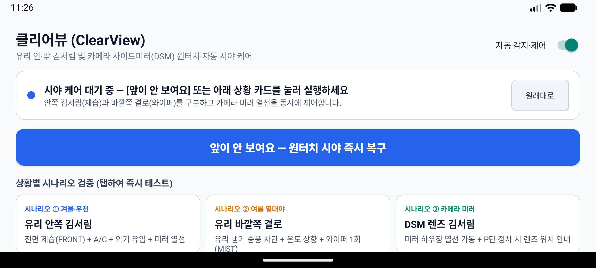
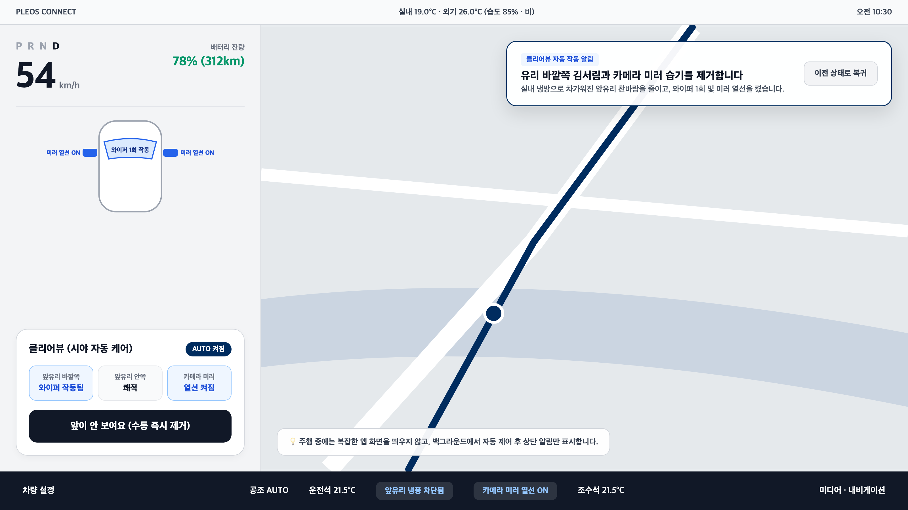
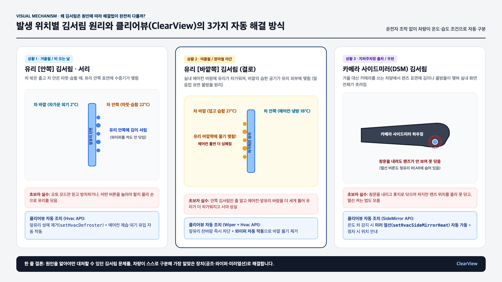

# 클리어뷰 (ClearView)

## 1. 앱 이름 및 한 줄 소개
- **앱 이름**: **클리어뷰 (ClearView)**
- **한 줄 소개**: 유리 **안쪽·바깥쪽 김서림 원인**을 스스로 구분해 공조·와이퍼를 정밀 제어하고, **카메라 사이드미러(DSM) 렌즈 열선 및 위치 안내**까지 챙겨 주는 Pleos Connect 원터치·자동 시야 케어 앱입니다.

---

## 2. 실행 방법

### 방법 A. 빌드된 Release APK 바로 설치 및 실행 (권장)
저장소 내 `apk/` 폴더에 서명 완료된 실행 가능한 Release APK가 포함되어 있습니다.

```bash
# ADB가 연결된 Pleos Connect 에뮬레이터 또는 Android 기기에 설치
adb install -r apk/ClearView_ClearView_release.apk

# 앱 즉시 실행
adb shell am start -n ai.pleos.playground.clearview/.MainActivity
```

### 방법 B. 소스 코드에서 직접 빌드 및 실행
본 프로젝트는 Pleos Connect 공식 Maven 저장소(`https://nexus-playground.pleos.ai/repository/maven-releases/`)의 `ai.pleos.playground:Vehicle:2.3.2` SDK를 사용합니다.

```bash
# 1. 저장소 클론 후 프로젝트 폴더 이동
git clone <REPOSITORY_URL>
cd clearview-pleos

# 2. Release APK 빌드 (JDK 17 또는 21 필요)
./gradlew assembleRelease

# 3. 생성된 APK 확인
ls -lh app/build/outputs/apk/release/app-release.apk
```

---

## 3. 테스트 환경 및 필요한 설정

### 테스트 환경
| 항목 | 사양 및 설정 |
| :--- | :--- |
| **Target OS** | Pleos Connect (Android Automotive OS, API 28 ~ 34) |
| **Compile / Target SDK** | Android API 34 (`compileSdk = 34`, `minSdk = 28`) |
| **Vehicle SDK** | `ai.pleos.playground:Vehicle:2.3.2` |
| **JDK / Gradle** | JDK 17+ (OpenJDK 21 검증 완료), Gradle 8.9 (`./gradlew` 포함) |
| **권장 해상도** | Pleos Connect 가로형 IVI 디스플레이 및 일반 Android 에뮬레이터 모두 호환 |

### 필요한 설정 및 심사자 검증 가이드
별도의 외부 API 키나 하드웨어 장비 없이도 **에뮬레이터 및 심사 환경에서 즉시 모든 시나리오를 검증**할 수 있도록 대화형 시뮬레이션 및 하드웨어 폴백 스위치를 내장했습니다.

1. **`[앞이 안 보여요 — 원터치 시야 즉시 복구]` 버튼**
   - 초보 운전자가 당황했을 때 버튼 하나로 현재 실내·외 이슬점($T_{dew}$)을 분석하여 최적의 제습·열선·와이퍼 제어를 즉시 수행합니다.
2. **상황별 시나리오 검증 카드 (① ~ ③ 탭하여 즉시 테스트)**
   - **시나리오 ① 유리 안쪽 김서림 (겨울·우천)**: `HVAC.setHvacDefroster(FRONT_WINDSHIELD, true)` + `setHvacAc(true)` + `setHvacRecirculation(false)` + `SideMirror.setHvacSideMirrorHeat(1)` 동시 가동
   - **시나리오 ② 유리 바깥쪽 결로 (여름 열대야 에어컨 역효과)**: 유리 방향 찬 바람 송풍 차단(`FanDirectionType.FACE`) + 설정 온도 `+2℃` 상향 + 와이퍼 1회 작동(`WiperSwitch.MIST`)
   - **시나리오 ③ 카메라 사이드미러(DSM) 렌즈 김서림**: 미러 하우징 열선 가동 + 정차(`P`단) 시 **카메라 렌즈 실제 물리적 위치 가이드** 표시
3. **하드웨어 미지원 차량(기본형 트림) 폴백 검증**
   - 화면 중간의 **`[트림 전환: 풀옵션 ↔ 기본형(미지원 폴백)]`** 버튼을 누르면 `checkHvacDefrosterCapabilities` / `checkHvacSideMirrorHeatCapabilities` / `checkWiperSwitchCapabilities` 결과에 따라 미지원 하드웨어(오토 와이퍼, 미러 열선 등) 감지 시 **1단계 음성(TTS)·화면 조작 코칭**으로 자동 전환되는 모습을 확인할 수 있습니다.

---

## 4. APK 파일 위치 또는 GitHub Release 링크

- **저장소 내 APK 경로**:
  - [`apk/ClearView_ClearView_release.apk`](./apk/ClearView_ClearView_release.apk) (영문 표준 파일명: `팀명_앱이름_release.apk`)
  - [`apk/ClearView_클리어뷰_release.apk`](./apk/ClearView_클리어뷰_release.apk) (국문 앱명 병기본)

---

## 5. 핵심 화면 및 동작 원리

### 실제 빌드 APK 실행 화면 (Android Emulator 구동 캡처)


### Pleos Connect 상단 비간섭 알림 및 원인별 해결 원리




